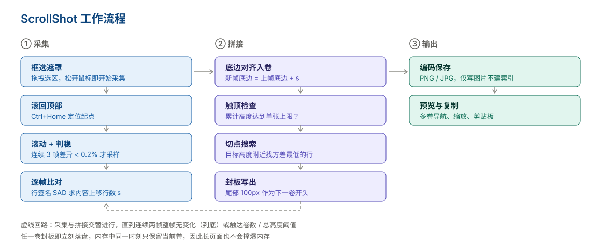

# ScrollShot 滚动截图

Windows 上的滚动截图工具：框选任意可滚动区域，自动滚动、逐帧比对、拼接成长图；内容太长时自动分卷保存，切点尽量落在代码行之间的空白处。

最初为这个场景写：内网机器上的代码文本带不出来，只能截成图带给外网的 AI 看。所以做成单文件、零依赖、纯离线——拷进去就能用，不需要装东西、不需要管理员权限、不需要联网。工具本身在外网用 AI 辅助开发，代码公开。

- 单文件 exe，自带运行时，**不需要管理员权限，不需要装 .NET**
- 纯 Win32 + WPF 实现，**零第三方依赖**
- 拼接按像素级对齐，周期重复内容（聊天记录、代码块）不会叠字



## 功能

| 能力 | 说明 |
|---|---|
| 框选即采 | 松开鼠标立刻开始，不需要二次确认 |
| 自动判稳 | 连续 3 帧画面稳定才采样，兼容平滑滚动与惯性滚动 |
| 像素级对齐 | 每帧计算内容上移了多少行，误差 1px 以内 |
| 低置信度保护 | 匹配不确定时不硬拼，用历史位移中位数兜底并记告警 |
| 自动分卷 | 超过单张最大高度自动切卷，卷间保留重叠保证上下文连续 |
| 切点优化 | 在目标高度附近搜索方差最低的行，尽量不把代码行切断 |
| 中断可控 | 采集过程中可暂停、停止、停止并丢弃当前卷 |
| 托盘常驻 | 关闭窗口收进托盘，全局热键随时唤起 |
| 多格式输出 | PNG / JPG（可调质量），默认自动复制首张到剪贴板 |

## 系统要求

- Windows 10 / 11，x64
- 构建需要 [.NET 10 SDK](https://dotnet.microsoft.com/download/dotnet/10.0)
- 运行不需要任何运行时（发布产物为 self-contained 单文件）

## 下载

最新稳定版 **[ScrollShot v1.0.0](https://github.com/zhaoronghui/scrollshot/releases/latest)**（Windows 10 / 11，x64）。

| 文件 | 大小 | 说明 |
|---|---|---|
| `ScrollShot-v1.0.0-win-x64.zip` | 约 61 MB | Releases 里的附件 |
| └ `ScrollShot.exe` | 约 149 MB | 解压后得到，自带 .NET 10 运行时 |

下载 zip → 解压 → 双击 exe 即用，**不用安装、不用管理员权限、不用联网**。拷到 U 盘带进内网机器也能跑。

> Releases 页面自动附带的 `Source code (zip)` 是源码包，不含编译产物；要直接用程序请下载上面那个附件。

## 从源码构建

只想用现成程序的话，下载上面的 zip 即可。下面是自己编译（需要 .NET 10 SDK）：

```bash
git clone https://github.com/zhaoronghui/scrollshot.git
cd scrollshot/src/ScrollShot

# 调试构建
dotnet build

# 发布绿色单文件（产物：bin/Release/net10.0-windows/win-x64/publish/ScrollShot.exe）
dotnet publish -c Release
```

## 使用

1. 启动 `ScrollShot.exe`，主窗口出现，托盘出现图标
2. 按 `Ctrl+Alt+S`（或点主窗口「开始滚动截图」、托盘右键「开始截图」）
3. 在屏幕上拖拽框选要截取的区域
4. **松开鼠标即开始采集**，右上角出现胶囊控制条
5. 采集结束后自动弹出预览窗，图片已存到输出目录

| 操作 | 快捷键 |
|---|---|
| 开始截图 | `Ctrl + Alt + S`（可在设置中修改） |
| 取消框选 | `Esc` 或鼠标右键 |
| 中止采集 | `Esc` 或胶囊上的「停止」 |

默认保存位置：`%USERPROFILE%\Pictures\滚动截图`
配置与日志：`%AppData%\ScrollShot\`

## 工作原理

滚动截图的难点不在截屏，而在**判断每次滚动到底移动了多少像素**——只有算准这个数，重叠部分才能不重不漏地接上。

```
框选 → 滚到顶部 → [ 滚动 → 判稳 → 算位移 → 校验 → 入卷 ] × N → 分卷落盘 → 预览
```

三个关键点：

**1. 用差异像素比例判稳，不用哈希**

编辑器的插入光标会一直闪烁，整帧哈希永远不相等，判稳会一直等满采样上限（实测每帧 4 秒）。改成统计"有多少比例的像素发生了变化"，光标闪烁只占 0.x%，不会误判。

**2. 模板固定在当前帧上，不随候选位移移动**

对每个候选位移 `s` 都重新取一次模板带，会让不同候选比较**不同的画面**，SAD 曲线失去可比性。遇到周期性重复的内容（同一段回复重复几百像素），多个候选都接近 0，取最小值的那个经常是错的——拼出来就是文字叠字。现在模板固定取当前帧的一段，所有候选都是"同一块内容在不同位置的对齐程度"。

**3. 按底边定位，不按顶边**

新帧底边 = 上一帧底边 + 位移量 `s`。这样当 `s` 小于帧高时，新帧顶部会落在上一帧内部，重叠区被后帧覆盖，卷内既不会重复也不会空洞。按顶边摆放（新帧顶边 = 上帧底边）每帧会平白多出 `帧高 - s` 行重复内容。

详细推导与踩坑记录见 [docs/tech-notes.md](docs/tech-notes.md)。

## 项目结构

```
scrollshot/
├── src/ScrollShot/
│   ├── App.xaml.cs              启动、单实例、托盘
│   ├── MainWindow.xaml.cs       热键、流程编排、Esc 钩子
│   ├── SelectionOverlay.xaml.cs 全屏框选遮罩
│   ├── CaptureSession.cs        采集循环主控（判稳/匹配/校验/入卷）
│   ├── Capture/
│   │   ├── FeatureMatcher.cs    行签名 SAD 位移匹配
│   │   ├── StabilityDetector.cs 稳定帧检测
│   │   ├── ScreenCapture.cs     BitBlt 截屏提供器
│   │   ├── WgcCapture.cs        WGC 提供器（未实装）
│   │   └── DpiHelper.cs         DPI 换算
│   ├── Scroll/ScrollController.cs  窗口定位与滚轮/按键注入
│   ├── Stitch/
│   │   ├── VolumeManager.cs     分卷封板引擎
│   │   └── ImageUtil.cs         帧差与落盘
│   ├── Settings/Config.cs       配置持久化
│   └── NativeMethods.cs         P/Invoke 声明
├── tools/verify_stitch.py       卷间衔接自检脚本
└── docs/
    ├── article.md               使用介绍与推荐（公众号稿）
    ├── tech-notes.md            技术复盘
    ├── video-script.md          演示视频分镜与旁白
    └── images/architecture.svg  采集流程示意图
```

## 文档

| 文档 | 面向 | 内容 |
|---|---|---|
| [docs/article.md](docs/article.md) | 使用者 | 场景、下载、三步操作、设置、已知限制与推荐理由 |
| [docs/tech-notes.md](docs/tech-notes.md) | 开发者 | 技术复盘：判稳、位移匹配、底边对齐、分卷切点的四次踩坑 |
| [docs/video-script.md](docs/video-script.md) | 内容制作 | 演示视频分镜表、旁白全文与拍摄清单 |
| [docs/images/architecture.svg](docs/images/architecture.svg) | — | 采集流程示意（本页顶部引用） |

## 主要配置项

配置文件 `%AppData%\ScrollShot\config.json`，也可在设置窗口中修改。

| 键 | 默认 | 说明 |
|---|---|---|
| `Hotkey` | `Ctrl+Alt+S` | 全局热键 |
| `ScrollStepRatio` | `0.70` | 每次滚动占选区高度的比例 |
| `ScrollMethod` | `Wheel` | `Wheel` 或 `PageDown` |
| `WaitMs` | `300` | 滚动后等待时间 |
| `StableFrames` | `3` | 判稳所需连续稳定帧数 |
| `MaxVolumeHeight` | `6000` | 单张图片最大高度（px） |
| `VolumeOverlap` | `100` | 卷间重叠像素 |
| `CutPointOn` | `true` | 是否启用切点优化 |
| `OutputFormat` | `PNG` | `PNG` 或 `JPG` |
| `CaptureApi` | `BitBlt` | `BitBlt` 或 `WGC` |

## 已知限制

- **仅支持纵向滚动**，横向滚动截图未实现
- **WGC 提供器是空壳**，选 `WGC` 会自动回退到 `BitBlt`。BitBlt 在 GPU 直绘窗口、部分远程桌面场景下可能截到黑屏
- **混合 DPI 多屏**下按主屏缩放比例换算，跨不同缩放的显示器时选区可能有偏差
- 依赖 `Ctrl+Home` 把内容滚回顶部；不响应该快捷键的应用可能从中间位置开始截
- 不支持需要权限提升的窗口（UAC 安全桌面）

## 自检

采集完成后可以用脚本验证输出的多卷是否真的连续：

```bash
pip install pillow numpy
python tools/verify_stitch.py "C:\Users\<你>\Pictures\滚动截图"
```

卷间衔接的平均灰度差应该接近 `0.000`；如果明显大于 0，说明卷与卷之间存在断裂。

## License

[MIT](LICENSE)
