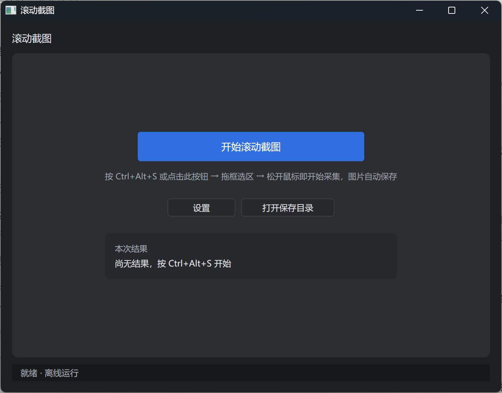
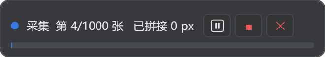
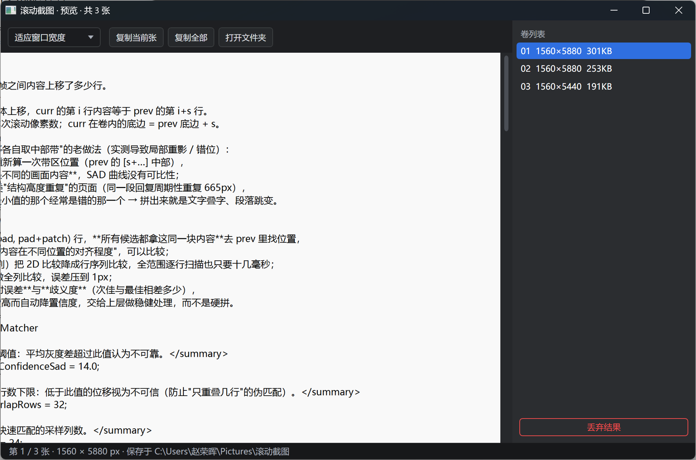
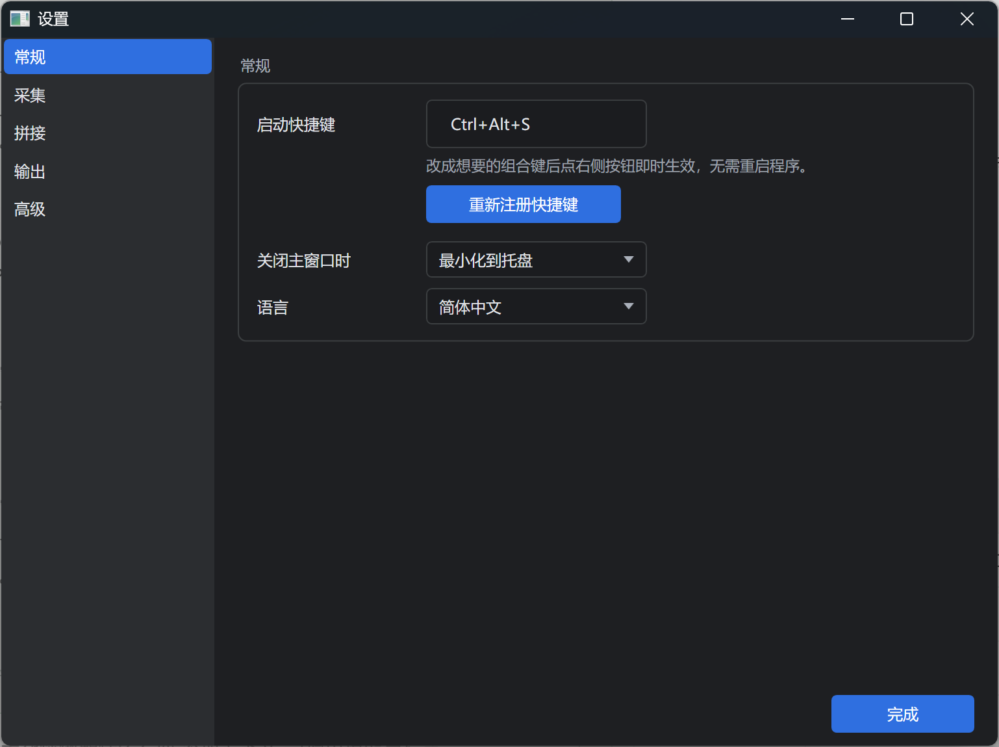

# 内网代码想给外网 AI 看？这个免费小工具，三步截成一张长图

> 绿色单文件、不联网、不用装运行时，框选一下自动滚到底，拼成一张不叠字、不断行的长图。工具是在外网用 AI 辅助写的，大概一个下午，代码开源免费。

---

## 一、它解决的是哪件麻烦事

起因很具体：内网机器上的代码，我看得见，但文本带不出来——不能复制粘贴到外网，也不能把文件传出去。可我又想让外网的 AI 帮我读它、解释它、改它。

剩下唯一能带出去的形态就是**截图**。（什么内容可以带出去、什么不行，按公司规定来，这里不展开。）

问题是一屏装不下一个文件。几百行代码要滚七八屏，逐屏截图再一张张发给 AI，它拿到的是一堆碎片，上下文全断。得拼成一张**连续的长图**才有用。

同一件事还有别的版本：长网页存档、聊天记录留证、PDF 里的长表格、写完的文档发给不看电脑的人。只要内容超过一屏，需求都一样。

---

## 二、先说结论：为什么值得装

|             | 普通截图 | 在线长图工具       | 常见滚动截图软件    | ScrollShot  |
| ----------- | ---- | ------------ | ----------- | ----------- |
| 超过一屏        | 不行   | 可以           | 可以          | 可以          |
| 要联网 / 上传内容  | 不用   | **要，内容得出本机** | 部分要登录       | **全程离线**    |
| 要安装 / 管理员权限 | 不用   | 不用           | 大多要装        | **不用，双击即用** |
| 拼接质量        | —    | 看服务          | 常有叠字、白带、重复段 | 像素级对齐，接缝可自检 |
| 价格          | 免费   | 限高 / 会员      | 限高 / 会员     | 免费，MIT      |

对我最关键的其实是**第二行和第三行**：内网机器装不了东西、也连不了外网，一个拷进去就能跑、又不会把内容传到任何服务器的单文件，几乎是唯一能落地的形态。

顺便说清楚：这工具是**在外网用 AI 辅助写的，从提需求到能出图大概一个下午**。所以这篇不谈实现，只谈它好不好用、怎么用。想看踩坑和原理，仓库里另有一篇技术复盘。



*图 1｜主窗口：一个「开始滚动截图」按钮就是全部入口，底部状态栏写着「就绪 · 离线运行」。*

---

## 三、怎么拿到

**方式一：直接拿编译好的单文件**

当前版本 **v1.0.0**，已经发布，直接下载：

<https://github.com/zhaojzjx/scrollshot/releases/latest>

找到附件 `ScrollShot-v1.0.0-win-x64.zip`（约 61 MB），解压出 `ScrollShot.exe`（约 149 MB，自带 .NET 10 运行时）。拷到 U 盘带进内网机器，双击就能跑，不用安装、不用管理员权限、不用联网。

> Releases 页面自动附带的 `Source code (zip)` 只是源码包，别下错了。

**方式二：自己编译**（外网机器上，装了 .NET 10 SDK 就行）

```bash
git clone https://github.com/zhaojzjx/scrollshot.git
cd scrollshot/src/ScrollShot && dotnet publish -c Release
```

产物在 `bin/Release/net10.0-windows/win-x64/publish/ScrollShot.exe`。

> 【可选配图：Releases 页面，圈出 zip 附件 —— 发布时自行截一张即可】

---

## 四、三步用起来

**第 1 步：启动**

双击 exe，主窗口出现，托盘多一个蓝色图标。关掉主窗口不会退出，它会收进托盘常驻，随时可用；右键托盘图标可以打开窗口或彻底退出。想让 X 直接结束进程，在「设置 → 关闭主窗口时」改成「退出」。

**第 2 步：按 `Ctrl+Alt+S`，框选区域**

屏幕变暗进入框选状态，用鼠标拖出要截的窗口区域。**只框内容区**，别把标题栏、任务栏框进去——框多大，长图就多宽。

**第 3 步：松开鼠标，开始**

不需要再点确认。程序会自己把内容滚回顶部，然后一屏一屏地滚、截、拼。选区外出现一条胶囊控制条，显示当前进度（自动避开选区，不会被截进长图）。到底或按停止后，自动弹出预览窗，图片已经存好。

| 操作     | 快捷键 / 方式                        |
| ------ | ------------------------------- |
| 开始截图   | `Ctrl+Alt+S`（或主窗口「开始滚动截图」、托盘右键） |
| 取消框选   | `Esc` 或鼠标右键                     |
| 中止采集   | `Esc` 或胶囊上的「■」                  |
| 打开设置   | 主窗口「设置」/ 托盘「设置…」                |
| 打开保存目录 | 主窗口「打开保存目录」/「打开文件夹」             |



*图 2｜采集中选区外的胶囊条：进度、暂停、停止并保存、丢弃当前卷。*

---

## 五、采集中途能干什么

胶囊会自动停在选区外的空位，采集期间固定不可拖动（避免拖进选区被截进长图）。**采集时鼠标始终归你控制**：程序不再每帧把光标拉来拉去，可以正常移开、点别的窗口；**鼠标一移到胶囊上还会自动让行**——暂停滚动，胶囊显示「已让行 · 移开鼠标继续」，可以从容点按钮，移开即恢复采集。上面三个按钮：

- **⏸ 暂停 / 继续**：临时要动一下鼠标、切个窗口时用
- **■ 停止并保存**：不想滚到底了，已经拼好的部分照样出图
- **✕ 停止并丢弃当前卷**：这一卷不要了，直接作废

`Esc` 随时中止。这几个按钮看着不起眼，但真到截一个几百屏的页面时，能不能中途刹车，体验差别很大。

---

## 六、结果在哪，怎么交给 AI

默认存到 `图片\滚动截图`，文件名像 `ScrollShot_20261107_185500_01.png`，按时间加卷号排好，不会覆盖历史结果。

- 默认 **PNG**，设置里可切 **JPG**（默认质量 90），要发给 AI 时体积能小不少
- **采集完自动把首张复制进剪贴板**——这是我最常用的路径：截完直接 `Ctrl+V` 粘进 AI 对话框，一步都不用多走
- 预览窗里可以缩放查看（适应窗口宽度 / 100% / 适应窗口），检查接缝处的文字有没有重影
- 预览窗还有「复制当前张」「复制全部」「打开文件夹」「丢弃结果」四个按钮

主窗口的结果区也留了「预览」「复制首张」「打开文件夹」，采完关了预览窗也能找回来。



*图 3｜预览窗：右侧卷列表列出自动分出的多卷，上方一排按钮可直接复制当前张、复制全部、打开文件夹。*

> 【可选配图：把长图粘进 AI 对话框的效果 —— 发布时补一张】

---

## 七、内容太长会怎样：自动分卷

单张 PNG 有高度上限，几万像素也扛不住内存。所以超过 **6000 像素**就自动切一卷，存一张，继续截。

有两个细节是为"给 AI 看"做的：

- **切点尽量落在行间空白处**，不会把一行代码拦腰切断，上下两张各剩半个字
- **卷与卷之间保留 100 像素重叠**，翻看时上下文是连续的，不会突然断掉

给 AI 时按顺序把几张图一起传、并在提示里说明"这是同一份代码的连续第 1/2/3 段"，它就能当一份完整材料读。

准不准不用信我：仓库里带了 `tools/verify_stitch.py`，采完跑一下，卷间衔接的平均灰度差应该是 `0.000`（逐像素一致），不是 0 就说明接断了。依赖安装和命令见仓库 README 的「自检」一节。

---

## 八、几个常用设置

设置窗口分「常规 / 采集 / 拼接 / 输出 / 高级」五组，改动即时保存、不用重启程序（只有快捷键要额外点一下「重新注册快捷键」）。多数人默认值就够，只列几个真会用到的：

| 想解决什么       | 改哪里              | 建议                  |
| ----------- | ---------------- | ------------------- |
| 快捷键跟别的软件冲突  | 常规 → 启动快捷键       | 改完点「重新注册快捷键」        |
| 担心滚动太快漏内容  | 采集 → 滚动步长        | 新版已自动限制单帧不超过选区 55%，一般无需调整；特殊应用可调到 0.5–0.6 |
| 某应用滚轮没反应    | 采集 → 滚动方式        | 换成 `PageDown`       |
| 滚动后画面还没画完   | 采集 → 滚动后等待       | 默认 300ms，调到 500     |
| 需要摆好窗口再开始   | 采集 → 开始前倒计时      | 默认关闭                |
| 想控制单张大小     | 拼接 → 单张最大高度      | 默认 6000px           |
| 想换保存位置 / 格式 | 输出 → 保存位置 / 默认格式 | 也可直接改 `config.json` |
| 不想自动占剪贴板    | 输出 → 自动复制        | 关掉即可                |



*图 4｜设置窗口：左侧五组，右侧是快捷键等常用项，改动即时保存。*

配置文件在 `%AppData%\ScrollShot\config.json`，日志也在同目录，出问题可以直接翻。

---

## 九、哪些情况不适用

推荐也得说清楚边界，免得白折腾：

- **只支持纵向滚动**，横向滚动截图没做
- 依赖 `Ctrl+Home` 把内容滚回顶部；不响应该快捷键的应用，可能从中间开始截
- 默认用 BitBlt 截屏，**GPU 直绘窗口、部分远程桌面场景可能截到黑屏**；设置里的 WGC 选项目前是预留，选了会自动回退
- **混合 DPI 的多显示器**（比如一台 100%、一台 200%）：按主屏缩放换算，跨屏框选可能有偏差
- 不支持需要提权的窗口（UAC 安全桌面）

---

## 十、为什么敢推荐

不是因为它功能多，恰恰是因为它**只做一件事，而且能验证**：

1. **离线、零依赖、零上传**。整个过程不联网，截图不经过任何服务器——要给 AI 看的内容，先得保证没在别处留过副本。
2. **拼接质量可自检**。叠字、白带、重复段落这类错，肉眼要滚到很下面才发现；工具给了逐像素验证的办法。
3. **代码全公开，MIT**。想改、想审、想自己编译都行，不存在"免费版藏了什么"的问题。
4. 一个下午用 AI 写出来的小东西，没打算做成大产品，也就没有账号、会员、广告这些负担。

如果你也在内网里对着带不出来的代码发愁，或者只是想找个不用登录、不用联网、双击就能用的长图工具，可以试试。

---

- **下载**：<https://github.com/zhaojzjx/scrollshot/releases/latest>
- **仓库**：<https://github.com/zhaojzjx/scrollshot>
- **技术复盘**：仓库内 `docs/tech-notes.md`
- **协议**：MIT，免费可商用。

*工具与本文均由 AI 辅助完成，从提需求到能出图约一个下午。如果对你有帮助，欢迎转发，或去仓库点个 star。*

---

## 附：配图清单（发布时用，可删）

文中 4 张图均为 v1.0.0 的真实界面截图，文件在仓库 `docs/images/`：

| 图 | 文件 | 用在哪一节 |
|---|---|---|
| 图 1 | `main-window.png` | 二、为什么值得装 |
| 图 2 | `capsule.png` | 四、三步用起来 |
| 图 3 | `preview-window.png` | 六、结果在哪，怎么交给 AI |
| 图 4 | `settings-window.png` | 八、几个常用设置 |

公众号编辑器不认 Markdown 相对路径，发布时按上表顺序把图片上传、替换文中引用即可，图注可以直接复制。另有两处标了「可选配图」的位置，需要的话自行补图。
